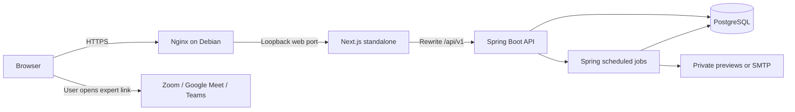
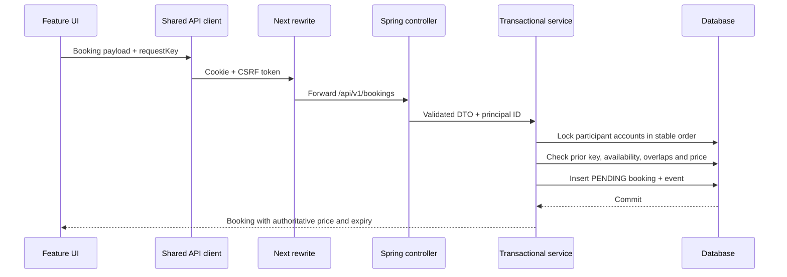
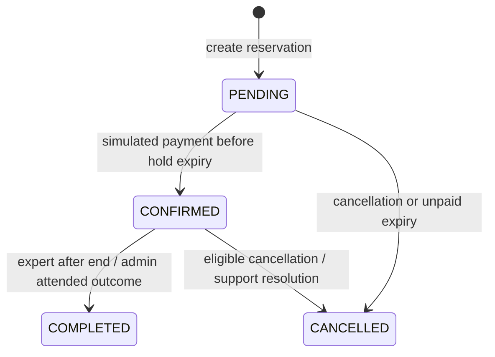

# Internal architecture

Updated from code on 24 October 2026. See the [handbook](DEVELOPER-HANDBOOK.md) for product context and the [data model](DATA-MODEL.md) for schema details.

## Runtime topology

NexAdvisor has a Next.js web process and a Spring Boot application with layered domain modules. The database is the shared authority for sessions, scheduling, money simulation and queued mail. Background jobs run inside Spring; they are not separate containers.

Local startup skips Nginx and uses file-backed H2 in `backend/data/`. Deployed Compose starts database, API and frontend in health order. API and database have no public host ports. The frontend proxy destination comes from BACKEND_URL at build time; rebuild when changing it. PUBLIC_ORIGIN controls generated application links. Do not use the demo profile for deployment.

## Request and trust boundaries

Controllers handle HTTP/validation; services handle business decisions and transactions; repositories normally own SQL and row mapping. Java `entity` records are immutable projections, not JPA entities. The layering is a convention rather than a fully enforced boundary: OperationsService, ReschedulingService and AccountService contain direct JdbcClient SQL; ReadinessController and CashfreeWebhookController also query/write directly. When extending these areas, preserve current transactions and consider extracting SQL into focused repositories rather than describing a refactor that has not happened.

## Authentication and security

- Spring Session JDBC persists sessions with the `NEXADVISOR_SESSION` cookie. It is HTTP-only, SameSite=Lax and secure by default; local launcher explicitly permits HTTP. Session timeout is 30 minutes.
- Passwords use Spring Security PBKDF2. Login invalidates the previous session and installs an AccountPrincipal with role authority. Public registration accepts only client/expert, never admin.
- GET `/api/v1/csrf` supplies token/header name. Browser writes, including public auth writes, require CSRF. Only the Cashfree callback route is exempt and has its own signature verification.
- Protected endpoints authenticate at the filter layer, then services enforce role/ownership. Many inaccessible booking lookups return 404 to avoid exposing another person's records.
- Restriction/closure revokes sessions; the security filter checks account availability on subsequent requests. Mutating paths use account locks and active-account rechecks where implemented. Review both pre-lock and post-lock state when adding a new write.
- AuthThrottle uses hashed keys in a database fixed-window counter: 30 attempts/key/15 minutes, atomic across instances. Calls commit independently of rejected business transactions. Proxy traffic limits are a separate concern.
- Verification/reset links use token digests, expiry and single-use consumption. Password reset revokes persisted sessions. Preview email files contain live token URLs and must remain private.

## Booking state machine

COMPLETED is terminal for normal participant actions. An admin support full-refund resolution can change a completed paid booking to CANCELLED. Booking status, payment status and payout status are separate fields; never derive one solely from another.

Creation requires verified CLIENT role, a published expert and a future available slot within 90 days. Duration is 30 or 60 minutes. The server calculates `ceil(hourlyRateMinor * duration / 60)` in integer minor units and snapshots currency. The hold expires at the earlier of creation + 15 minutes and appointment start.

Creation/payment/cancellation/completion/expiry serialize using participant account rows locked in stable UUID order. Availability and time-off writes lock the expert account so concurrent booking checks share a lock. Overlap checks include the client's and expert's active calendars, excluding expired unpaid holds. SQL uniqueness is a second line of defense, not a substitute for the lock protocol. Never add a write path that skips the same locks.

Booking creation uses `(client_id, request_key)` idempotency. A repeated identical operation returns the existing booking; differing expert/original start/duration/notes returns 409. V12 stores original_start so retries remain recognizable after rescheduling. Payment and cancellation are also repeatable without creating a second financial event. Message retry keys are optional at the API boundary for compatibility; current UI supplies them and the database enforces uniqueness per sender.

For a paid future appointment, a client can self-cancel with full simulated refund at least one hour before start, including the exact boundary. Within an hour, Support must review. The expert can cancel a future session with full refund. Unpaid future holds can be cancelled. Normal completion is expert-only after the appointment ends. Cancellation/completion closes pending reschedule proposals and expires obsolete notices.

## Timezones and rescheduling

Weekly hours store weekday/minutes in the expert's named timezone, one interval/day, half-hour boundaries. `ScheduleTimes` maps local candidates to real instants: DST gaps are skipped, both valid offsets of ambiguous starts can be returned, and transition-crossing sessions are excluded. Appointment times and time-off ranges travel as UTC instants. Changing recurring hours/timezone does not move existing bookings.

Rescheduling requires a confirmed simulated-paid booking at least an hour before start, active participants and no open support case. Only one pending proposal is allowed. The request includes originalStart to reject stale UI. A proposal does not reserve its target or release the original appointment. The other participant must accept; either may decline/withdraw. Acceptance reacquires locks and rechecks both calendars/time off. Price and duration stay fixed. It clears the old meeting link, expires old queued notices, updates the booking and queues new notices in one transaction. Conflicts leave the original appointment intact.

## Financial simulation and support

PaymentService calls PaymentRepository/FinanceRepository within the booking transaction. One payment and finance snapshot exist per booking. Default commission is 2500 basis points; rounding uses `(gross * bps + 5000) / 10000`, and net equals gross minus commission. Historical migration backfills use zero commission instead of retroactive fees.

Payout starts HELD. An admin may simulate payout only when the booking is completed/paid, at least 48 hours past end, and has no open issues. Refunds reverse the settlement; a refund after simulated payout records PAYOUT_RECOVERY. Unique `(booking_id,kind)` finance events protect repeated actions. Reconciliation checks internal records and totals, not bank/provider statements.

Support attendance outcomes are manual operator findings. No-show cancels but leaves money held for a separate refund decision. Audit records capture operator action and note. This is not automated video attendance detection.

## Outbox, meeting links and jobs

Booking changes enqueue notifications in their business transaction. CommunicationJobs polls due mail every 10 seconds (up to 25 rows), and reminders/missing-link checks every minute. BookingExpiryJob checks expired holds every minute. JobBatch catches individual item failures so later items continue. AuthThrottle cleans old windows every 15 minutes.

Delivery locks participants for booking mail and then the outbox row, rechecks state/expiry and calls preview/SMTP transport. Failures back off and become FAILED after five attempts; expired/sent sensitive bodies are cleared according to repository rules. SMTP runs while that delivery transaction holds locks, so latency can affect booking contention. Provider acceptance followed by a process/database failure can still duplicate delivery. There is no exactly-once mail guarantee or separate broker.

Meeting links are expert-provided HTTPS URLs validated against allowed providers. Only booking participants read them; only the booked expert updates active confirmed appointments. Ended/cancelled bookings return an empty link. Readiness exposes near-term missing links and pending proposals; providers control admission and meeting availability.

## Errors and observability

RequestIdFilter generates X-Request-ID and marks API responses no-store. ApiErrors maps domain/validation/conflict/availability/unexpected exceptions to safe responses with message, code and requestId. Security-filter/proxy failures may have a different body; the client handles that fallback. The UI times out at 20 seconds and never automatically replays mutations. A timeout does not prove rollback.

Logs omit sensitive exception text in the API handler and identify failure class/location/reference. `/actuator/health` exposes health without details. Admin operations shows failed email, open issues, deletion requests and readiness counts. Host monitoring, backup timers, TLS and external uptime checks need deployment configuration; they are not started merely because a Java job exists.

## Extension constraints

Add migrations rather than modifying applied SQL. Preserve account-lock order and revalidate under lock. Do not accept frontend totals or trust browser redirects as payment proof. Preserve currency and commission snapshots. Keep public DTOs free of private review notes and token data. See [launch gate](LAUNCH-GATE.md) before adding live providers; the signed Cashfree receipt endpoint currently has no transaction application logic and does not enforce timestamp freshness beyond format validation.
