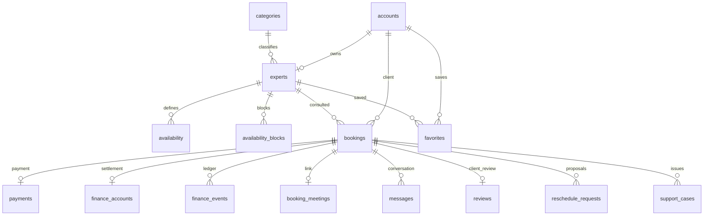

# Data model and persistence

Updated 24 October 2026 through V12. SQL in [the migration directory](../backend/src/main/resources/db/migration/) is authoritative; this is a conceptual guide, not replacement DDL. PostgreSQL is the deployment database; H2 PostgreSQL-compatibility mode supports local use/tests. Java uses JdbcClient and immutable record projections rather than ORM entities.

## Core relationships

Relationships omitted for readability include message senders, support reporters, audit actors and authorization token owners. The expert's account ID is reached through experts; do not confuse an expert profile UUID with an account UUID.

## Table catalog

| Table/group | Meaning and constraints | Main owner |
| --- | --- | --- |
| `accounts` | Unique normalized email; password hash; CLIENT/EXPERT/ADMIN role; verified, suspended and disabled flags | AccountService / AccountRepository |
| `categories` | Seeded category identifiers and display metadata | ExpertRepository |
| `experts` | One profile/account; category, rate, currency, approval/review note, photo and named schedule timezone | ExpertService / ExpertRepository |
| `expert_reviews` | Administrative profile-review history; distinct from client consultation reviews | ExpertRepository |
| `availability` | Expert weekday and minute interval, interpreted in expert timezone | ExpertRepository / ScheduleTimes |
| `availability_blocks` | Time-off start/end instants; conflict rules enforced under expert lock | TimeOffRepository |
| `bookings` | Expert/client, current start/end, original start, price/currency snapshot, state, notes, hold expiry and request key; unique client/key | BookingRepository |
| `booking_events` | Booking transition history with actor/action | BookingRepository |
| `reschedule_requests` | Requester, original/proposed start, PENDING/ACCEPTED/DECLINED; UUID is retry key; pending-per-booking enforced by service under lock | ReschedulingService |
| `payments` | One simulated payment/booking, amount/currency/provider/status | PaymentRepository |
| `finance_accounts` | One settlement/booking; gross, commission basis points, fee, net, currency, payout state; gross = fee + net | FinanceRepository / OperationsService |
| `finance_events` | COLLECTION, REFUND, PAYOUT, PAYOUT_RECOVERY; unique booking/kind | FinanceRepository |
| `booking_meetings` | One current provider URL/booking | MeetingRepository |
| `messages` | Booking, sender, content, timestamp; optional request key unique per sender | ConversationRepository |
| `reviews` | One client review/booking; rating 1–5 and comment | ConversationRepository |
| `favorites` | Composite account/expert primary key | ExpertRepository |
| `support_cases` | Booking/reporter/category/description/status/resolution/response; unique booking/reporter | OperationsService |
| `deletion_requests` | One request/account; OPEN, IN_REVIEW, ANONYMIZED | OperationsService |
| `operations_audit` | Actor, polymorphic target UUID, action and note; target_id is not a single-domain FK | OperationsService / AccountControlService |
| `launch_checks` | Evidence/actor/time keyed by approved operational checklist item | OperationsService |
| `policy_acceptances` | Composite account/version with acceptance timestamp | AccountService |
| `password_resets`, `email_verifications` | Per-account token digests, expiry/consumption metadata; do not store raw link tokens here | RecoveryRepository / VerificationRepository |
| `mail_outbox` | Unique semantic event key, recipient/body, attempt scheduling, expiry, sensitivity and optional booking/kind | MailRepository |
| `provider_receipts` | Cashfree raw-body digest and provider receipt metadata; not a payment record | CashfreeWebhookController |
| `auth_rate_limits` | SHA-256 key plus fixed window primary key, atomic attempt count 1–30 | AuthThrottle |
| `SPRING_SESSION`, `SPRING_SESSION_ATTRIBUTES` | Database-backed authentication sessions and serialized attributes | Spring Session |
| `flyway_schema_history` | Applied migration versions/checksums | Flyway |

## State and value conventions

- IDs are UUIDs except named lookup/check keys and composite keys. HTTP exposes camelCase; SQL uses snake_case.
- Appointment instants use timezone-aware timestamps. Weekly hour integers are local wall-clock minutes, not UTC timestamps. Day 1 is Monday.
- Amounts are integer minor units, not floating-point major currency values. New experts default to INR, but historical currency is preserved. Currency must travel with every displayed amount.
- Booking state: PENDING, CONFIRMED, COMPLETED, CANCELLED. Expired unpaid holds become CANCELLED with an EXPIRED_UNPAID event; EXPIRED is not a booking state.
- UNPAID is the booking projection when no payment exists. Stored payment states are SIMULATED_PAID/SIMULATED_REFUNDED. Settlement states include HELD, SIMULATED_PAID and REVERSED.
- Outbox states include PENDING, SENT, FAILED, EXPIRED. PREVIEW writes still mark the outbox item SENT, meaning handled by that transport, not delivered to a real inbox.
- Profile status is PENDING, APPROVED or REJECTED. Suspension is an account flag, not a fourth profile status.

## Migration map

| Version | Change |
| --- | --- |
| V1 | Accounts, directory, schedules, bookings/payments/events, messages/reviews/favorites and JDBC sessions |
| V2 | Booking hold expiry |
| V3 | Recovery tokens, outbox and provider meeting links |
| V4 | Email verification |
| V5 | Time-off blocks |
| V6 | Profile photo storage/version |
| V7 | INR default for new experts, finance snapshots/events, support/deletion/audit/launch checks and disabled accounts |
| V8 | Provider receipt deduplication |
| V9 | Policy acceptance |
| V10 | Retire known fictional public expert profiles |
| V11 | Expert schedule timezone, account suspension and reschedule proposals |
| V12 | Original booking start, shared authentication counters, message retry keys and lookup indexes |

Read all migrations, not just V1, when inspecting current constraints. V7 preserves historical payment amounts/currencies and backfills zero commission. V12 recovers the initial booking start from accepted reschedule history when available. New deployments run the whole history; upgrades run only pending versions.

## Consistency, deletion and maintenance

Uniqueness protects request/payment/event duplication; temporal overlap protection relies on transactional participant locks and queries. There is no general SQL exclusion constraint preventing every possible out-of-band overlapping booking. Direct manual inserts can violate application invariants even when SQL accepts them.

Account closure anonymizes identifying/authored data and disables login while retaining linked financial/audit records. Do not cascade-delete an account and its ledger. Backup retention, historical audit notes, external messages and preview files require separate operational handling.

Use a new numbered migration for schema changes and test fresh install plus upgrade where relevant. Never manually modify Flyway checksums to hide a mismatch. Take backups before deployment migrations. Automated integration tests delete fixture tables and are guarded to accept only in-memory H2 or the explicitly disposable PostgreSQL `nexadvisor_test`; do not use that name for real data.
